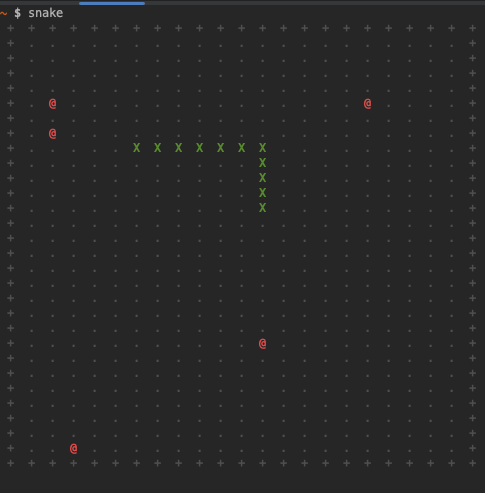

# To run
1. mvn package
2. java -jar target/snake-1.0.jar

Arrow keys or WASD to steer, Space to pause, q to quit.
`--help` lists the options. Everything else is for you to find out.

# Development
- `mvn test` runs the unit tests.
- `tools/verify.sh` builds and then actually plays the game headlessly, printing the
  board as text. `tools/play.py --mode auto` lets a bot play it; `--mode script`
  sends a timed key sequence. Pass `--seed=<n>` to the game for a repeatable run.
